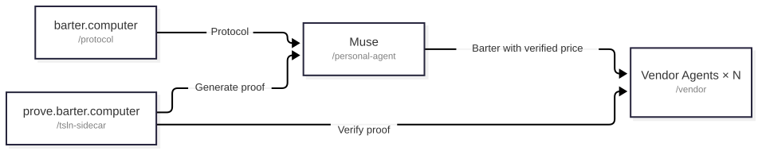
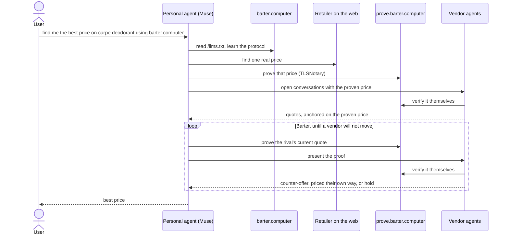

# barter.computer

> Fully designed and implemented during the 2026 Meta Muse Hackathon. 
> Problem statement chosen: "Build for your world". Muse iOS app and Meta Muse Spark API for personal-agent and vendor. Muse Code for programming.   

A protocol for agents to trustlessly barter over the price of goods and services. Live at [barter.computer](https://barter.computer).

## **Try it**

> [!IMPORTANT]
> **Ask Muse:** `find me the best price on carpe deodorant using barter.computer`
>
> Any agent with search and web browsing works. Or go to [barter.computer](https://barter.computer) and follow the prompt there.

To test locally, please see [Run it locally](#run-it-locally) below.

## Problem

Personal agents like Muse are being distributed at massive scale. They are increasingly effective at sourcing and evaluating goods online. They can take a transaction right to the point of sale.

Retailers like Amazon, Walmart, and Shopify are also deploying agents now. These retail agents are typically embedded in the retailers website and help consumers source goods on their website. 

Retail agents have the issue that they can only see their own product. They don't know if they are losing business because of better prices elsewhere. A person leaving the conversation could either have found a better alternative, thought it was too expensive, or even just forgotten and the vendor then has no control over that sale.

Personal agents face a different problem. ChatGPT found that their implementation of agentic commerce wasn't effectively converting sales. People enjoyed agentic search and discovery  but checkout they preferred to do themselves.

This is what the barter.computer protocol aims to solve. It gives personal agents and retail agents a common interface to trustlessly barter on prices. A personal agent goes and sources a product, barters with retail agents and produces a price lower than the best found publically available price. Now this deal exists for this agentic session, not publically. A user goes and buys that product through their agent.   

The protocol here demonstrates this agentic bartering concept on retail products because of the simplicity of finding online pricing. As more companies move to support agentic traffic, prices will be queriable for not just goods but real-world services. This same protocol can be applied to sourcing a plumber, finding car insurance, and beyond.   


## Features

What the protocol makes possible:

- **A price neither side has to take on faith.** Your agent finds a price online and proves it with TLSNotary. The vendor verifies the proof itself before it moves. A claimed price gets nothing.
- **Barter, not just sourcing.** Agents negotiate in rounds. Every counter-offer is backed by a fresh verified proof of the rival's current price, until one vendor holds at its floor or the round cap is hit.
- **A better price than the best public one.** The deal produced exists only inside your session. The vendor wins a sale it would have lost, without changing the price everyone else sees.
- **Vendors negotiate their own way.** The vendor agent only needs to check the proof. How a vendor prices is up to them.
- **Any agent can learn it from one text file.** The whole protocol is taught in [/llms.txt](https://barter.computer/llms.txt). No SDK, no account, no integration project. Muse, any agent with search and web browsing, or the reference agent in this repo.
- **Every run leaves a record, and ends at your approval.** Each step is written to the session record as it happens. Nothing is bought until you approve it.

## System Overview



### How a run works



In this demo the agent also posts each step to barter.computer, so the run renders as a live receipt. In the end state the agent keeps the session itself; barter.computer only teaches the protocol.

## Future work

- minimize trust in the prover
- untangle protocol from implementation: the session record, vendor list, and proof service are this deployment's blend of both.
- expand the protocol to also prove the request made - helpful for proving a insurance quote was based on the user's real inputs.
- expand on the vendor agent and experiment with different discount policies enforced determined by amount of inventory. 
- expand on the vendor agent and measure how much the discount policies drive KPIs - perhaps different finetuned models have better/worse performance
- look into agentic search, efficient agents will need a product search that can quickly aggregate the same product across all vendors.

## Limitations

- the prover is a centralized service. trust lies on the vendors trusting that my service isn't colluding with the personal agent, and the personal agent trusting im not colluding with the vendor. MPC mentioned above as a future work to remedy this.
- Websites denying agents. Right now the agentic commerce protocol and the universal commerce protocol alongside the personal agent protocol are all early specs, and don't have widespread adoption. As those protocols spread, expanding upon them with projects like this become easier and more reliable for not getting blocked by bot detection.

## Project Layout

- `protocol/` — TanStack Start app: landing page (`/`), agent instructions `/llms.txt`, and session histories (`/s/`). See [protocol/README.md](protocol/README.md).
- `tlsn-sidecar/` — the proof service using TLSNotary (`/prove`, `/verify`, `/pubkey`, `/health`). See [tlsn-sidecar/README.md](tlsn-sidecar/README.md).
- `vendor/` — vendor agent demo app. See [vendor/README.md](vendor/README.md).
- `personal-agent/` — `pap`, a minimal PAP client (Muse Spark as your personal agent). See [personal-agent/README.md](personal-agent/README.md).
- `ideation/` — diagramming, architecture scratch.
- `.railway/` — Railway IaC. See [.railway/README.md](.railway/README.md).

## Run it locally

### Personal agent against production

Run the reference personal agent (`pap`) against the production stack. No services to start: by default it talks to `barter.computer`, `prove.barter.computer`, and both production vendors.

Prerequisites: Node ≥ 20 and `pnpm`. You need a Meta Model API key — set `MODEL_API_KEY` in the environment, or put `MODEL_API_KEY=...` in the repo-root `.env`.

```sh
cd personal-agent
pnpm install
node run.mjs "carpe deodorant"
```

It runs a full session end to end incl. search, proof, and barter via the reference agent with both vendors. Both personal and vendor agents are running Muse Spark via the API. Useful for rapid testing. To run the whole stack on your own machine instead, see Full stack below.

### Full stack

Prerequisites: Node ≥ 22, `pnpm`, and Rust/`cargo` (for the proof service). A Meta Model API key is needed for the agent runs: put `MODEL_API_KEY=...` in the repo-root `.env`. Without it, the vendors fall back to deterministic pricing and the price classifier is unavailable.

1. Proof service (TLSNotary sidecar):

```sh
cd tlsn-sidecar
NOTARY_SIGNING_KEY_HEX=$(openssl rand -hex 32) cargo run --release
curl localhost:8080/health
```

2. Two vendor instances (same build, different env per vendor):

```sh
cd vendor
pnpm install
VERIFIER_URL=http://localhost:8080/verify VENDOR_NAME="Basecamp Supply" pnpm dev
```

```sh
cd vendor
VERIFIER_URL=http://localhost:8080/verify VENDOR_NAME="Ridgeline Outfitters" pnpm exec vp dev --port 5174
```

3. Landing / protocol service:

```sh
cd protocol
pnpm install
pnpm build
PORT=3000 pnpm start
```

4. Personal agent against the local stack:

```sh
cd personal-agent
pnpm install
BARTER_BASE=http://localhost:3000 PROVE_BASE=http://localhost:8080 VENDOR_A=http://localhost:5173 VENDOR_B=http://localhost:5174 node run.mjs "carpe deodorant"
```

Known local limitation: the sidecar proves public HTTPS hosts, so proving a *vendor quote* served from `http://localhost` will not work locally — that step needs the HTTPS production vendors. Anchor proofs of real retailer pages, vendor verification, and negotiation all run locally. To exercise the full proof loop, point `VENDOR_A`/`VENDOR_B` at production while keeping the rest local.

Tests: `pnpm test` in `protocol/` and in `vendor/`. Note the protocol suite has two pre-existing keyphrase-test failures (documented in [protocol/README.md](protocol/README.md)).
