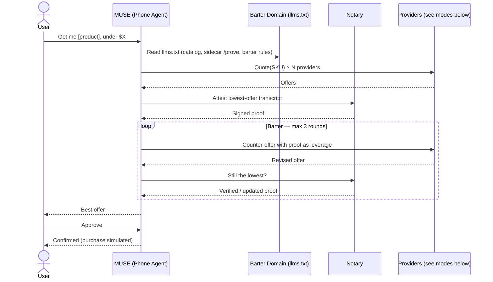

# Demo flows — hackathon

Two playable flows, same steps and same UI. Only the price sources differ.
Base diagram: [v1.mmd](v1.mmd) · Spec: [v1.md](v1.md)

## Shared flow

MUSE (the user's personal agent) is the orchestrator. There is no barter
server in the middle: `llms.txt` teaches MUSE the protocol, and each vendor
agent verifies proofs itself, trustlessly, before conceding.

1. User asks the phone agent (MUSE) in plain language: "Get me [product], under $[X]."
2. MUSE reads `llms.txt` on the barter domain: vendor discovery
   (`.well-known/poppy.json`), the poppy conversation protocol, and how to
   obtain TLSNotary presentations.
3. MUSE collects quotes from each vendor agent (same SKU everywhere — see Catalog).
4. MUSE obtains a TLSNotary presentation of the lowest offer: MUSE (prover)
   runs the MPC-TLS session with the notary (`tlsn-sidecar/`) and receives a
   selectively disclosed presentation of that vendor's real TLS response.
5. MUSE presents the proof to the vendor agent it is bartering with. The
   vendor agent verifies the presentation itself — notary key + server cert
   chain, no trust in MUSE or in any barter server — and only then concedes,
   per its discount policy. Each counter-offer is re-proved the same way:
   "still the lowest?"
6. After at most 3 rounds, MUSE returns the best offer to the user.
7. User approves. Purchase completes as simulated — no real checkout.

## Deployment (Railway IaC, barter.computer)

Defined in [`.railway/railway.ts`](../../.railway/railway.ts); see
[`.railway/README.md`](../../.railway/README.md) for plan/apply + DNS.

| Domain | Service | Role |
|---|---|---|
| barter.computer | `landing` | Landing page, `/llms.txt`, control panel |
| prove.barter.computer | `prove` | TLSNotary sidecar |
| basecamp.barter.computer | `vendor-basecamp` | Dummy vendor (barter target, $84/$68) |
| ridgeline.barter.computer | `vendor-ridgeline` | Dummy vendor (lowest quote, $72/$64) |

The Muse agent (on-device) is the orchestrator and is not deployed.

## Online demo — anyone can play

- Providers: **1 real + 2 simulated.**
  - Real: one anchor store catalog (real prices; agent interface simulated).
  - Simulated: two providers returning quotes for the same SKU.
- One simulated provider is quote-only. The other is the barter partner.
- Pricing is seeded per product (rehearsable), never bare random:
  barter provider opens above the anchor price, concedes 2–4% per
  proof-backed round, down to a hidden floor below the anchor.
  No valid proof → no concession.
- Must never break: cached prices with visible timestamps, 3-round cap,
  timeouts on every step.

## Live demo — judged run

- Providers: **3 real vendors.** Prices refreshed live from known product
  pages; vendor agent interfaces are simulated (vendors expose no agent
  search/barter API today).
- Catalog matching is solved in advance, not live (see Catalog).
- Fallback: if any vendor fetch fails (blocked, timeout, price missing),
  the flow degrades to the Online mode — same UI, same narration, cached
  prices shown with their capture time. Rehearse this switch.
- Purchase stays simulated at the approval gate.

## Catalog (both modes)

- Small closed catalog (~6 products). Each product is one exact SKU sold
  by all providers, joined by ISBN / UPC / model number.
- No variant-prone goods (sizes, colors, refurbished listings).
- Prices compared as total price (item + shipping).
- User picks by name; MUSE matches the name against the closed catalog
  only. No open-web product matching at demo time.

## Reliability checklist

- [ ] Price refresh attempted at demo start; cached fallback with timestamp.
- [ ] Barter capped at 3 rounds; every provider call has a timeout.
- [ ] Seeded pricing rehearsed end-to-end at least once per product.
- [ ] Online-mode fallback tested by forcing a vendor fetch failure.
- [ ] Approval gate reached in under ~90 seconds.
